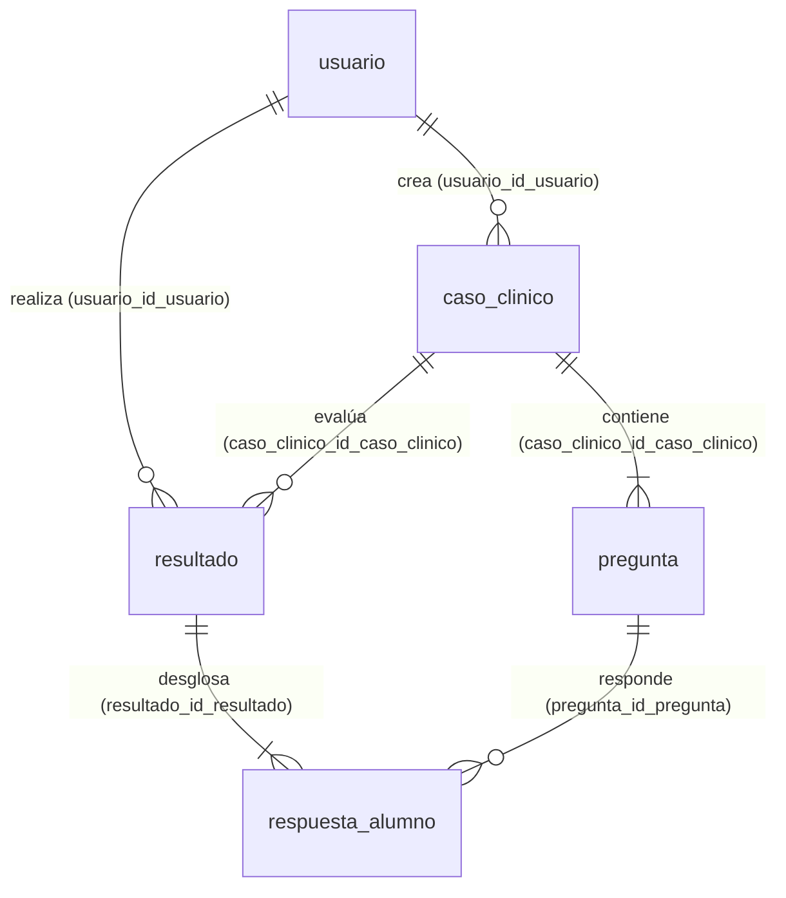

# Guía y Resumen de Avances: Migración de PulseLab a PostgreSQL / Supabase

> **Documento para el equipo de PulseLab:** Este archivo resume todo el análisis, diseño relacional, scripts y adaptadores construidos para migrar PulseLab de Firebase/Firestore a PostgreSQL y Supabase sin rehacer la interfaz en React.

---

## 1. ¿Por qué usamos PostgreSQL en lugar de MySQL?

1. **Supabase funciona sobre PostgreSQL:** Supabase es la alternativa relacional directa a Firebase y utiliza exclusivamente PostgreSQL como motor.
2. **Sin necesidad de programar un servidor backend desde cero:** Si usáramos MySQL puro, React no podría conectarse de forma segura desde el navegador sin programar toda una API REST intermedia (Node/Express). En cambio, Supabase expone automáticamente una API segura (`@supabase/supabase-js`) sobre las tablas de PostgreSQL.
3. **Row Level Security (RLS):** PostgreSQL permite traducir directamente nuestro archivo `firestore.rules` a políticas SQL a nivel de fila (`supabase/migrations/20261021000200_politicas_rls.sql`).
4. **Compatibilidad 100% con nuestro `Diagrama_ER.png`:** Aunque el diagrama original se dibujó en MySQL Workbench (`.mwb`), las **5 tablas y sus relaciones en español** se conservaron intactas en PostgreSQL (ajustando únicamente `TINYINT` → `BOOLEAN` y `DATETIME` → `TIMESTAMPTZ`).

---

## 2. Estructura de la Base de Datos Relacional (5 Tablas en Español)

Definida en `supabase/migrations/20261021000100_esquema_relacional_pulselab.sql`:



| Tabla en PostgreSQL | Qué reemplaza de Firestore | Clave Primaria (PK) | Claves Foráneas (FK) |
| :--- | :--- | :--- | :--- |
| **`public.usuario`** | Unifica `users`, `pending_users` y `student_accounts` | `id_usuario` (`BIGINT IDENTITY`) | — |
| **`public.caso_clinico`** | Datos generales y signos vitales de `clinical_cases` | `id_caso_clinico` (`BIGINT IDENTITY`) | `usuario_id_usuario` → `usuario(id_usuario)` |
| **`public.pregunta`** | Arreglo `questions[]` que antes estaba embebido en cada caso | `id_pregunta` (`BIGINT IDENTITY`) | `caso_clinico_id_caso_clinico` → `caso_clinico(id_caso_clinico)` (`ON DELETE CASCADE`) |
| **`public.resultado`** | Encabezado de `student_results` | `id_resultado` (`BIGINT IDENTITY`) | `usuario_id_usuario` → `usuario(id_usuario)`<br>`caso_clinico_id_caso_clinico` → `caso_clinico(id_caso_clinico)` |
| **`public.respuesta_alumno`** | Arreglo `answers[]` que antes estaba embebido en cada resultado | `id_respuesta_alumno` (`BIGINT IDENTITY`) | `resultado_id_resultado` → `resultado(id_resultado)`<br>`pregunta_id_pregunta` → `pregunta(id_pregunta)` |

---

## 3. Archivos nuevos y modificados en el repositorio

* **`supabase/migrations/20261021000100_esquema_relacional_pulselab.sql`**: Creación de las 5 tablas, PKs, FKs, `CHECK` constraints e índices.
* **`supabase/migrations/20261021000200_politicas_rls.sql`**: Reglas de seguridad RLS equivalentes a `firestore.rules` (un alumno solo ve casos publicados y sus propios resultados; un admin gestiona casos y usuarios).
* **`supabase/seed.sql`**: Datos de prueba reproducibles (1 docente/admin, 2 estudiantes, 1 caso clínico con preguntas y 1 intento con respuestas).
* **`src/api/supabaseClient.js` y `src/api/supabaseAdapter.js`**: Conectan React con Supabase y traducen automáticamente las columnas en español (`titulo`, `nombre_paciente`, `pregunta`, etc.) al formato que ya usan los componentes de React (`CaseEditor.jsx`, `CaseSession.jsx`, `Reports.jsx`, `UserManagement.jsx`).
* **`src/api/dataClient.js`**: Permite trabajar con Supabase (cuando `VITE_SUPABASE_URL` está configurada), con PostgreSQL local en modo desarrollo, o con Firebase/LocalStorage.
* **`scripts/test-local-db.js`**: Script automatizado que crea las tablas localmente, inserta `seed.sql` y comprueba llaves foráneas, restricciones y consultas `JOIN`.
* **`scripts/migrate-firestore-to-postgres.js`**: Script repetible e idempotente para migrar un respaldo de Firestore a las 5 tablas de PostgreSQL.
* **`scripts/vite-local-pg-plugin.js`**: Puente local en Vite + Inspector visual de PostgreSQL en `http://localhost:5173/api/local-pg`.

---

## 4. Cómo correr las pruebas en local (Para cualquier integrante del equipo)

Solo se necesita tener **Node.js** instalado (no hace falta instalar Docker ni configurar servicios manuales, porque el proyecto incluye `@electric-sql/pglite` como motor PostgreSQL 16 embebido de respaldo si no hay un servidor en `localhost:5432`):

```bash
# 1. Instalar dependencias
npm install

# 2. Correr pruebas de esquema, llaves foráneas y consultas JOIN
npm run db:test

# 3. Probar el script de migración de Firestore a PostgreSQL
npm run db:migrate

# 4. Iniciar la aplicación web conectada al PostgreSQL local
npm run dev
```

Una vez encendido `npm run dev`:
* **App de PulseLab:** `http://localhost:5173/` (incluye botones de acceso rápido como Docente o Estudiante contra PostgreSQL local).
* **Inspector de estructura y datos de PostgreSQL en vivo:** `http://localhost:5173/api/local-pg`

---

## 5. Cómo subir esto a Supabase Cloud

1. Crear un proyecto en [supabase.com](https://supabase.com).
2. Ir a **SQL Editor** en el panel de Supabase y ejecutar:
   * Primero: `supabase/migrations/20261021000100_esquema_relacional_pulselab.sql`
   * Segundo: `supabase/migrations/20261021000200_politicas_rls.sql`
   * Opcional (datos de prueba): `supabase/seed.sql`
3. Copiar las credenciales del proyecto en el archivo `.env`:
   ```env
   VITE_SUPABASE_URL=https://tu-proyecto.supabase.co
   VITE_SUPABASE_PUBLISHABLE_KEY=tu-anon-o-publishable-key
   ```
